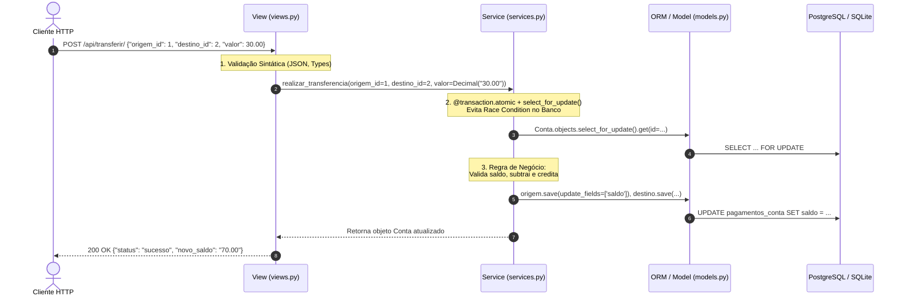

# Django Clean Architecture & Lead Developer Guide 🚀

Projeto de referência e guia prático para desenvolvedores com background em **FastAPI / SQLAlchemy** migrando ou se aprofundando em **Django**, aplicando **Simple Design**, **Clean Architecture (Service Layer)** e **CI/CD de Alto Nível** para entrevistas de Lead Developer.

---

## 1. O Conceito: "Project" vs. "App" no Django

No Django, existe uma separação clara entre a infraestrutura global e os domínios da aplicação:

- **Project (`config/`)**: Representa a configuração global do sistema. Contém `settings.py` (banco de dados, middlewares, apps habilitados, segurança), `urls.py` raiz (roteamento central) e os pontos de entrada ASGI/WSGI.
- **App (`pagamentos/`)**: Representa um módulo ou domínio coeso e independente do sistema. Cada app encapsula seus próprios Models, Migrations, Services, Views, URLs e Testes.

```
django/
├── config/                  # Django PROJECT (Configuração Global)
│   ├── __init__.py
│   ├── settings.py          # Settings com suporte a 12-Factor (DATABASE_URL, DEBUG, etc.)
│   ├── urls.py              # Root URLConf
│   ├── wsgi.py
│   └── asgi.py
├── pagamentos/              # Django APP (Domínio Pagamentos / Transferências)
│   ├── migrations/          # Versionamento do esquema SQL gerado pelo Django
│   ├── models.py            # Definição das Entidades / Tabelas
│   ├── services.py          # REGRA DE NEGÓCIO PURA (Clean Architecture)
│   ├── views.py             # Adaptador HTTP (Input validation & status codes)
│   ├── urls.py              # Roteamento do App
│   ├── admin.py             # Configuração do Django Admin
│   └── tests/               # Suíte Pytest isolada
│       ├── test_models.py
│       ├── test_services.py
│       └── test_views.py
├── .github/workflows/
│   └── ci.yml               # Pipeline de CI/CD (Ruff, Mypy, Bandit, Postgres 16)
├── pyproject.toml           # Configurações de Ruff, Mypy e Cobertura
├── pytest.ini               # Configurações do Pytest + Django
├── requirements.txt         # Dependências congeladas
└── manage.py                # CLI do Django
```

---

## 2. Fluxo da Arquitetura (Services vs. Fat Views / Fat Models)

Em tutoriais convencionais de Django, os desenvolvedores frequentemente cometem o erro de colocar lógica de negócio diretamente dentro da `View` (acoplando a regra ao protocolo HTTP) ou inflando os `Models` com dezenas de métodos ("Fat Models").

Adotando a **Clean Architecture** (Service Pattern), o fluxo de execução é limpo, desacoplado e 100% testável:



---

## 3. Comparativo Prático: FastAPI vs. Django

| Conceito | FastAPI | Django (Lead Developer Standard) |
| :--- | :--- | :--- |
| **Definição de Tabela** | SQLAlchemy `Base` Model | Django `models.Model` |
| **Migrations** | Alembic (`alembic revision --autogenerate`) | Django nativo (`makemigrations` / `migrate`) |
| **Lógica de Domínio** | Service functions / classes puras | `services.py` puros com `@transaction.atomic` |
| **Validação HTTP** | Pydantic Schemas / Body parameters | `json.loads` / Serializers / Forms na View |
| **Controle de Concorrência** | `session.execute(select(...).with_for_update())` | `Conta.objects.select_for_update().get(...)` |
| **Testes** | `pytest` com `httpx.AsyncClient` | `pytest` com `pytest-django` e `@pytest.mark.django_db` |

---

## 4. Concorrência e Transações Seguras

Na função `realizar_transferencia` ([pagamentos/services.py](file:///Users/joaoedu/PROJETOS/django/pagamentos/services.py)):

1. **`@transaction.atomic`**: Toda a operação é executada dentro de uma transação de banco de dados (`BEGIN ... COMMIT`). Caso ocorra qualquer exceção (como saldo insuficiente ou falha de rede), o Django executa automaticamente um `ROLLBACK`, impedindo inconsistências (por exemplo, dinheiro debitado da conta de origem sem creditar no destino).
2. **`select_for_update()`**: Executa a query com `SELECT ... FOR UPDATE` no banco relacional (ex.: PostgreSQL). Isso adquire um lock pessimista a nível de linha nas duas contas envolvidas, garantindo que duas requisições simultâneas não debitem o mesmo saldo ao mesmo tempo (proteção contra *Race Conditions* e *Double Spending*).
3. **`save(update_fields=["saldo"])`**: Prática recomendada em produção. Em vez de enviar todos os campos da tabela no comando SQL `UPDATE`, envia apenas a coluna modificada, reduzindo tráfego e prevenindo sobrescrita acidental de outros campos concorrentes.

---

## 5. Como Executar Localmente

### 5.1. Ativar o Ambiente Virtual
```bash
source .venv/bin/activate
```

### 5.2. Rodar Migrações
```bash
python manage.py makemigrations
python manage.py migrate
```

### 5.3. Executar a Suíte de Testes com Cobertura (Pytest + xdist)
```bash
pytest -n auto --cov=. --cov-report=term-missing --cov-fail-under=85
```

### 5.4. Verificação de Código (Linters & Segurança)
```bash
ruff check .
ruff format --check .
mypy .
bandit -r . -x ./tests,./pagamentos/tests,./venv,./.venv
```

### 5.5. Iniciar o Servidor de Desenvolvimento
```bash
python manage.py runserver
```

Teste o endpoint de transferência via cURL ou HTTP:
```bash
curl -X POST http://127.0.0.1:8000/api/transferir/ \
  -H "Content-Type: application/json" \
  -d '{"origem_id": 1, "destino_id": 2, "valor": "30.00"}'
```

---

## 6. O CI/CD Pipeline e os 3 Diferenciais de Lead Developer

O workflow [.github/workflows/ci.yml](file:///Users/joaoedu/PROJETOS/django/.github/workflows/ci.yml) implementa dois jobs paralelos:

1. **Job 1: `code-quality`**: Roda em ~20 segundos com Ruff, Mypy e Bandit.
2. **Job 2: `tests`**: Provisiona um serviço Docker de **PostgreSQL 16 real**, roda migrações, validação de deploy e suíte distribuída de testes.

### 🌟 3 Destaques para Mencionar em Entrevistas Técnicas:

1. **`python manage.py makemigrations --check --dry-run`**:
   - *Problema comum:* Em times médios e grandes, é frequente um desenvolvedor alterar um campo no `models.py` e esquecer de rodar `makemigrations` antes de abrir o Pull Request.
   - *Solução:* O CI executa uma checagem seca. Se houver qualquer divergência de model sem arquivo de migration gerado e commitado, o CI quebra imediatamente.

2. **`python manage.py check --deploy`**:
   - *Problema comum:* Ambientes configurados com falhas silenciosas de segurança (como `DEBUG=True` acidental, `SECRET_KEY` fraca ou padrões de cookies inseguros).
   - *Solução:* O Django audita a integridade do `settings.py` e da arquitetura do projeto contra a checklist oficial de segurança para produção.

3. **`pytest -n auto` (`pytest-xdist`)**:
   - *Problema comum:* Conforme a suíte cresce para centenas de testes acessando PostgreSQL, o tempo de execução passa de minutos, desestimulando a cultura de testes rápidos.
   - *Solução:* O `pytest-xdist` detecta o número de núcleos de CPU disponíveis no runner do GitHub Actions e distribui os testes em paralelo, criando bancos de dados de teste isolados para cada worker.
